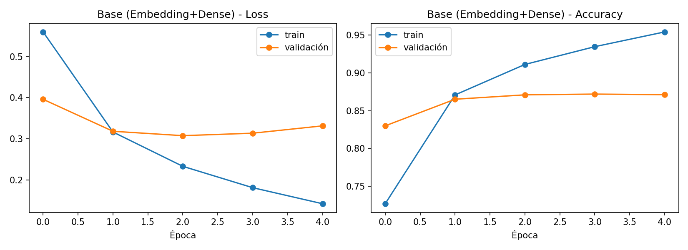
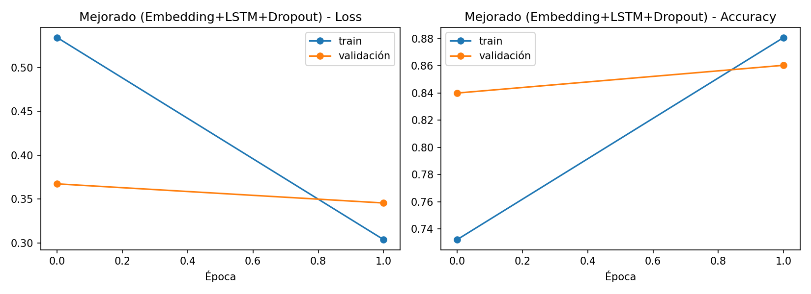

# Agente neuro-agéntico de triaje de reseñas

## 1. Identificación, ruta y propuesta de valor

**Integrantes:** Juan Sebastián Burgos, Estiben Yessid Jiménez
**Ruta elegida:** Ruta 3, PLN con Embeddings + Agente de Triaje Inteligente
**Dataset:** IMDB Reviews (20.000 reseñas de train, 5.000 de validación y 25.000 de test)

### ¿Por qué red neuronal + agente y no solo un prompt a un LLM?

La red neuronal permite unicamente identificar si una reseña es positiva o negativa,
sino que también nos enseña una probabilidad que es posible analizar y comprobar. Por
ejemplo, en nuestras pruebas se obtuvieron 0.7734 en una reseña positiva y 99.31 % de
confianza en una negativa. Otra ventaja es que funciona de manera local, sin depender
de servicios externos ni consumir cuota de la API de Google.

Por otra parte, el agente interpreta las solicitudes del usuario y decide qué
herramientas utilizar. Esto se comprobó en el Caso 3, donde encadenó la red neuronal y
la política de escalamiento a partir de una sola petición. Además, en la prueba de
memoria recordó el nombre "Ana" usando su thread_id, sin mezclar esa información con
otro hilo.

### Responsabilidades

| Integrante | Componente desarrollado |
|---|---|
| Juan Burgos | Desarrollo del proyecto, entrenamiento y evaluación de la red neuronal, implementación del agente inteligente e integración de las herramientas |
| Estiben Jiménez | Pruebas y validación del funcionamiento, integración de componentes y documentación de la solución |


## 3. Ingeniería del modelo de red neuronal (U4) y análisis de un fallo real

### Arquitecturas e hiperparámetros

Ambos modelos reciben texto crudo: la capa `TextVectorization` (vocabulario de 20.000
palabras, secuencias de 200 tokens, ajustada solo con train para evitar fuga de datos)
está dentro del modelo. Embedding de 64 dimensiones, optimizador Adam (1e-3), pérdida
binary_crossentropy, batch de 64 y EarlyStopping (patience=2) sobre val_loss.

- **Base:** Embedding + GlobalAveragePooling1D + Dense(32) + salida sigmoide (1,282,113 parámetros).
- **Mejorado:** Embedding + Dropout(0.3) + LSTM(64) + Dropout(0.5) + salida sigmoide (1,313,089 parámetros).

### Curvas de entrenamiento vs. validación




| Modelo | Épocas | train_acc final | val_acc final | test_loss | test_acc |
|---|---|---|---|---|---|
| Base | 5 | 0.9542 | 0.8712 | 0.3444 | 0.8514 |
| Mejorado | 2 | 0.8808 | 0.8604 | 0.3847 | 0.8331 |

**Sobreajuste en el base:** El sobreajuste pasa cuando el modelo comienza aprender rápidamente los datos del entrenamiento, pero termina perdiendo capacidad para responder correctamente datos que no había visto. Esto se puede evidenciar en la epoca 3, donde obtuvo el mejor resultado en la perdida de validación, con un val_loss de 0.3075, pero sin embargo este valor aumento en la epoca 4 llego a 0.3135 y en la epoca 5 llego a 0.3313.

**Por qué el mejorado no superó al base:**2. la LSTM obtuvo un resultado inferior al modelo base. Esto debido a que solo se entreno durante dos epocas, y pudo no tener el suficiente tiempo para aprender correctamente las características de las reseñas. Teniendo en cuenta los datos de prueba el modelo base obtuvo una presición de 85.15% mientras que el modelo mejorado obtuvo 83.31%.

### Análisis de un fallo real

Índice de test **20409** | Real: POSITIVO | Predicción: NEGATIVO | P(positivo) = 0.0024.
Fue el error más confiado entre los 3715 errores de 25000.

En cuanto al caso 20409, se encontró un error en el modelo debido a que la reseña tenía una valoración real positiva, pero fue clasificada como negativa con una probabilidad positiva de 0.0024 (lo que equivale a un 0.24 %). Este error ocurrió porque la reseña empieza con *"Forget everything that you have ever read... especially if it was a negative review"* y menciona que la película *"rips off"* otra. Al contener palabras y expresiones de tono negativo, el modelo base —que simplemente promedia los vectores de las palabras sin considerar el orden ni la ironía— terminó inclinándose hacia una predicción negativa.

Limitación adicional: la frase corta "This movie was absolutely wonderful" dio
P(positivo) = 0.3716, porque el promedio incluye ceros de relleno.

## 2. Arquitectura del sistema

El sistema conecta una interfaz interactiva en **Streamlit** (`app.py`) con un agente **ReAct / LangGraph** respaldado por `gemini-2.5-flash` y memoria por sesión (`MemorySaver` + `thread_id`). El agente orquesta dos herramientas especializadas: la inferencia local de la red neuronal entrenada en la Unidad 4 (`clasificar_sentimiento`) y una herramienta de reglas de negocio (`consultar_politica_escalamiento`).

Conversación IA: [https://claude.ai/share/d8226537-8521-452c-9be3-26ca4a272afc](https://claude.ai/share/d8226537-8521-452c-9be3-26ca4a272afc)

```mermaid
flowchart TD
    U[Usuario] --> UI[Interfaz Web Streamlit - app.py]
    UI <--> AG[Agente ReAct / LangGraph - Gemini 2.5 Flash]
    AG <--> MEM[(Memoria Conversacional - MemorySaver / thread_id)]
    AG --> T1["@tool #1: clasificar_sentimiento (Red Neuronal U4)"]
    AG --> T2["@tool #2: consultar_politica_escalamiento (Reglas de Negocio)"]
    T1 --> MOD[(Pesos Entrenados - models/)]
